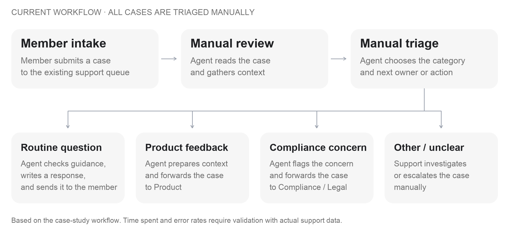
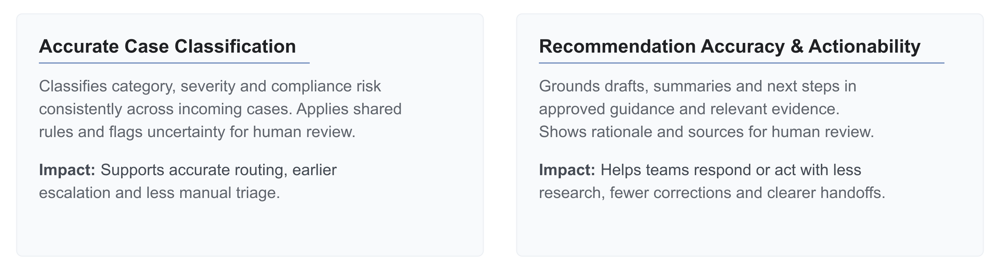

# RFC: Support Triage & Resolution Agent

## 1. Problem Statement & Hypothesis

**Problem:** Bankrate's Customer Support team manually triages hundreds of cases daily. This process does not scale with growing volume and is vulnerable to human error.

**Hypothesis:** By adding AI-assisted layers for case routing, case investigation, response drafting, and compliance handling—with policy controls and human approval before responding to the member —we can reduce case handling time and target the goal of resolving roughly 80% of intakes with AI assistance.

**Strategy Fit:** This will support Bankrate's AI-centered operating strategy by integrating AI layers into their Support pipeline while preserving human accountability and the existing  safety objectives. 

## 2. Context & Scope 

### Current Support Pipeline Flow

Currently, the Support agents manually read every case, gather context, choose a category, and either prepare a response or forward it to another team. These manual steps can cause time bottlenecks and more human error. 

### Proposed Support Pipeline Flow - AI Layers 

We propose adding AI layers with human approval gates to create one clear path from case intake through routing, investigation, and response or handoff.

### Initial scope

For this first release - we will focus on supporting three categories through one shared processing path:

- **Routine Q&A:** AI retrieves approved guidance and drafts a sourced response; Support reviews, edits, approves, or rejects it before delivery.
- **Product feedback:** AI prepares a minimal summary, authorized context, and policy-supported next steps; Support confirms the handoff, and Product validates recommendations.
- **Compliance-sensitive complaint:** AI blocks member drafting and prepares restricted internal context with optional historical assistance for Compliance/Legal; Support confirms the pilot handoff, while specialists validate evidence, investigate, and own any response.

**Build new**: Shared classification and orchestration, category configuration, safety checks, draft/summary preparation, human approval controls, and decision auditing.

**Wrap existing systems**: Connect to the ticketing/case system for intake and confirmed updates, the help-center knowledge base for approved guidance, and the member profile service for permitted read-only context.

**Leave unchanged**: Existing authentication, authoritative records, team queues, delivery channels, and manual handling. AI cannot independently make any member facing changes. 

### Core Value Propositions 

AI improves classification and actionable recommendations, with human oversight as the requirement at every stage.

## 3. AI Classification Rules

### Classification rules

- **Check before AI:** Validate intake, access, privacy and operating mode.
- **Classify intent and risk:** Identify category, potential severity and uncertainty - base this on similar case data and category configuration details. Compliance signals take priority and cannot be cleared by the model. Uncertain or failed classification goes to a human support member for manual routing.
- **Constrain the output:** Use only permitted sources and current supporting guidance. Require human approval before sending a response or confirming a handoff.

### Category configuration

Each category will have a configuration defining its allowed sources, output type, destination, and required human approvals. New categories can be added through reviewed configuration changes rather than separate processing paths, while shared code consistently enforces safety controls. 

### Performance:

- **Quality:** ≥95% correct routing overall and ≥90% per supported non-compliance category on held-out, human-labeled cases. 
- **Safety:** Zero observed compliance misses in the challenge set and zero missed compliance cases marked draft-eligible in representative review. 
- **Latency:** TBD
- **Max tokens:** TBD

## 4. AI Drafting Rules

Generate one concise, evidence-grounded output for human review: a routine resolution draft, a Product summary, or a restricted Compliance summary. 

### Inputs Available:

- Validated category, risk flags and permitted output type.
- Case description and relevant conversation history.
- Authorized member-profile fields. 
- Current approved guidance and category-specific policy.
- Eligible historical cases, including similarities, differences and prior handling.

### Constraints:

- Professional, clear and empathetic tone.
- Draft must include a direct answer, supported steps and source references.
- Internal summaries must include the reported issue, relevant context and policy-supported next steps.

### Disallowed:

- Member-response drafts for Compliance, Product or unresolved-risk cases.
- PII, confidential data or unauthorized context.
- Invented facts, sources, completed account actions or guaranteed outcomes.
- Sending, routing or changing accounts directly through model output.

## Performance:

- **Quality:** ≥90% of routine drafts usable without substantive factual correction; ≥90% of internal summaries/handoffs usable without substantive correction.
- **Safety:** Zero observed compliance member drafts.
- **Latency:** TBD
- **Max tokens:** TBD

## 5. Risks and Recovery

### Top Risks:

- **Unsafe answers:** Server rules block compliance member drafts, including with human approval. The model has no send credentials.
- **PII leakage:** Allowlist model inputs and team-handoff fields, check recipient access, and disable raw prompts, outputs and exception payloads in logs/traces.
- **Hallucination / abuse:** Require current supporting evidence; case text cannot override permissions, policy or approval gates.
- **Performance / low value:** Slow dependencies, burst traffic or excessive corrections.

### Detection:

- Scan generated outputs and handoffs for sensitive data; inspect logs/traces using privacy tests.
- Check drafts/sends against risk and approvals.
- Real-time response quality monitoring using trained classifier
- Latency alerting - TBD

### Fallbacks:

- **Low confidence or model failure:** Block member drafting and auto-resolution. Route to Support agent queue. 
- **Knowledge/profile unavailable:** Stop tasks needing missing evidence; never infer account state or fabricate answers. Route to support agent. 
- **Burst overload:** Cap concurrent calls and retries, reduce AI admission, prioritize compliance and route back to support agent manual handling.
- **Safety violation:** Pause affected drafting, delivery or exports; contain exposed data and assign support agent follow-up approval.

## 6. Rollout Plan for Business Teams

- **Align Success Metrics and Rubrics:** Work alongside the Support lead and both experienced agents to review real cases and agree what a good resolution means: accurate, policy-supported, understandable, correctly routed and unlikely to reopen. Build a shared review rubric and labeled examples. 
- **Shadow Mode:** After safety checks pass, show suggested classifications, routine response drafts and internal summaries and compliance case flags. Start in shadow mode, compare them with agents’ independent decisions; nothing routes or sends automatically. Agents approve or reject classifications and drafts before operational use. 
- **Review Loops:** Setting up consistent review/feedback loops - triaging meetings, slack channels, etc. Flag cases including missed concerns and escalations. Expect friction from extra review work, weak sources and lack of context. Make evidence and uncertainty visible, keep AI content rejection easy, and fix recurring problems before expanding. 
- **Expand with Evidence:** Move to a small assisted pilot where Support explicitly approves every member response and confirms handoffs. Track resolution quality, handling time and review effort against manual cases. Expand toward the 80% goal only when safety, usefulness and staffing gates pass; revisit the target if case mix limits safe coverage.
- **Hand over Ownership:** The Support lead owns workflow, training and weekly quality reviews; agents maintain examples and feedback. Compliance owns sensitive policy, while engineering owns integrations and incidents. Provide a runbook, dashboard, configuration/change process and named escalation contacts. Rehearse pausing and recovery, then have the team run a review-and-release cycle before the engagement ends.

## 7. Evaluation Plan

Evaluate **AI-assisted resolution (goal is 80%), time to case close and AI latency** against a manual baseline. Targets and sample sizes below are proposed.

- **Offline:** Test 500 representative and 200 compliance challenge cases. Require ≥95% routing accuracy, zero observed compliance misses.
- **Human review:** Assess 150 outputs (50 per category). Require ≥90% usable without major correction per category. Compliance outputs remain internal-only.
- **Online:** Compare members assigned to AI or manual support per month, including cases AI hands back to staff. Then check for reopened cases over seven days. Measure:
  - **AI-assisted resolution:** Target **80% of all unique cases** resolved using a human-approved AI draft without major correction or reopening.
  - **Time to close:** Elapsed time from intake to confirmed closure; compare median and P90, retaining open cases in the analysis.
  - **Time spent on case:** Total active staff minutes, including review, corrections and specialist work. Target **≥15% reduction**.
  - **Latency:** P50/P95 from AI request to review-ready output, including queueing and retrieval. Track timeouts separately; agree latency limits before the pilot.
- **Goal State when:** Quality gates pass, AI-assisted resolution reaches 80%, active handling time falls ≥15% with statistical evidence, and closure time improves without higher reopening or mishandling rates. Meet agreed latency limits and observe zero critical safety incidents. 

## 8. Next Steps

- **Support + Compliance:** Finalize category examples, mandatory blocks, escalation owners and acceptance thresholds.
- **Security + data owners:** Approve usable fields, historical-case access, provider processing and retention rules.
- **Engineering:** Confirm integration access, durable pending work, approval enforcement and kill-switch behavior; the prototype’s simulated controls require production implementation.
- **PM + Support lead:** Establish baseline handling time, representative case mix, pilot size and reviewer capacity.
- **AI response confidence + references:** Define and validate high/medium/low confidence levels based on evidence support, with source links and policy versions visible to reviewers. Distinguish response confidence from classification confidence; low confidence triggers human handling. Confidence never overrides compliance blocks or human approval.
- **Cost model:** Test the assumption that early classification and routing reduce cost by skipping response generation when it is unnecessary or blocked. Compare current manual cost with classification, retrieval, optional drafting/internal summaries, infrastructure and human review costs. 
